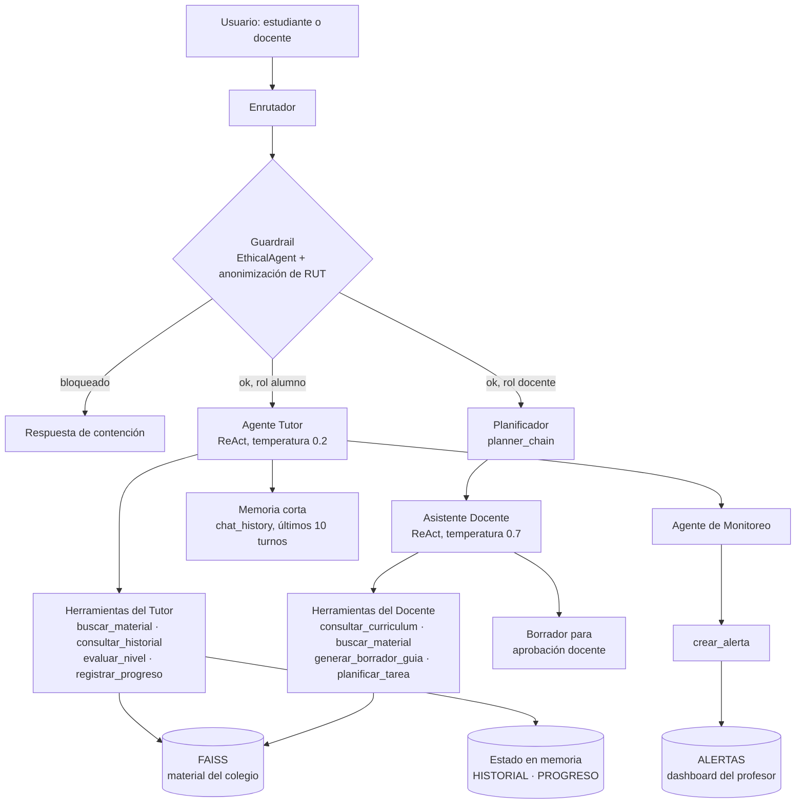

# evalucion2_IngenieriaIA


Evaluación Parcial N°2 · ISY0101 Ingeniería de Soluciones con IA · DuocUC

[](https://colab.research.google.com/github/TU_USUARIO/TU_REPOSITORIO/blob/main/Agente_Colegio_San_Pedro_EP2.ipynb)

**Integrantes:** Fernando villalobos, Nicolas Sotomayor, Joan rojas 

---

## 1. Descripción

Agente funcional basado en LLM y RAG que resuelve un requerimiento organización simulado de colegios  apoyar el aprendizaje de estudiantes y reducir la carga administrativa de los docentes.

El sistema tiene dos roles, cada uno con sus propias herramientas:

| Rol | Qué hace |
|---|---|
| **Tutor Virtual** (estudiante) | Responde dudas usando solo el material oficial del colegio, guía con pistas sin entregar el resultado, adapta la dificultad y registra el progreso. |
| **Asistente Docente** (profesor) | Recibe solicitudes complejas (por ejemplo, crear una guía), las planifica en pasos y genera **borradores** que el docente debe aprobar. |

Un **Agente de Monitoreo** revisa el progreso del curso y crea alertas para el profesor cuando detecta temas con muchos errores.

> Todo el sistema se ejecuta en **Google Colab** y **no usa base de datos**: el material vive en un índice vectorial FAISS en memoria y el estado (historial, progreso, alertas) en estructuras de Python.

## 2. Indicadores de logro cubiertos

| Indicador | Dónde se evidencia |
|---|---|
| **IL2.1** Agentes con herramientas de consulta, escritura y razonamiento | Sección 5: ocho herramientas repartidas por rol y agente ReAct (`run_agent`). |
| **IL2.2** Memoria y recuperación de contexto | Sección 6: historial de conversación, registros de progreso y recuperación semántica con FAISS. |
| **IL2.3** Planificación y decisiones adaptativas | Sección 7: Plan-and-Execute y reglas adaptativas (`evaluar_nivel`, monitoreo). |
| **IL2.4** Documentación del diseño | Este README, el diagrama de la sección 3 y el informe escrito. |

## 3. Arquitectura



### Flujo del Tutor

1. El enrutador recibe el mensaje y lo pasa por el guardrail.
2. Si es válido, el Tutor recibe el código del estudiante y el historial reciente.
3. El agente razona (Thought), elige una herramienta (Action) y lee el resultado (Observation) hasta producir la respuesta final.
4. La conversación se guarda en `chat_history` y el Agente de Monitoreo revisa los registros del curso.

### Flujo del Docente (Plan-and-Execute)

1. El planificador descompone la solicitud en pasos ordenados.
2. Cada paso lo ejecuta el agente con las herramientas del docente.
3. El resultado es un borrador que el docente debe revisar y aprobar.

## 4. Componentes y justificación de diseño

| Componente | Elección | Justificación |
|---|---|---|
| LLM | Mistral (`mistral-small-latest`) vía API compatible con OpenAI | Buen desempeño en español, bajo costo y se usa con el cliente estándar `openai`, por lo que es intercambiable por otro proveedor cambiando variables. |
| Embeddings | `mistral-embed` | Se usa la misma API key del LLM, lo que simplifica la configuración en Colab. |
| Base vectorial | FAISS en memoria | Cumple el requisito de no usar base de datos, es rápido para un corpus pequeño y no requiere servidor. |
| Chunking | `RecursiveCharacterTextSplitter` (500 caracteres, solapamiento 50) | Mantiene unidas las explicaciones y los ejemplos de cada concepto sin perder contexto en los bordes. |
| Recuperación | `retriever` con `k=4` | Entrega suficiente contexto al agente sin saturar el prompt. |
| Agente | Ciclo ReAct propio (`run_agent`) con el cliente `openai` | Control total del ciclo Pensamiento → Acción → Observación, con límite de 5 iteraciones para evitar bucles. |
| Planificación | `planner_chain` (LangChain) y ejecución paso a paso | Prioriza seguridad, bienestar del alumno, precisión académica y eficiencia, y permite explicar cada paso del plan. |
| Temperaturas | Tutor 0.2 y Docente 0.7 | El Tutor debe ser preciso y consistente; el Docente necesita más variedad para generar guías. |
| Seguridad | `EthicalAgent` (palabras clave) y anonimización de RUT | Protege a los menores y evita enviar datos personales al modelo. |

## 5. Herramientas (consulta, escritura y razonamiento)

| Tipo | Herramienta | Rol | Función |
|---|---|---|---|
| Consulta | `buscar_material` | Tutor y Docente | Recupera fragmentos del material oficial desde FAISS. |
| Consulta | `consultar_historial` | Tutor | Devuelve las notas del estudiante por su código. |
| Consulta | `consultar_curriculum` | Docente | Devuelve los objetivos de aprendizaje de una asignatura. |
| Escritura | `registrar_progreso` | Tutor | Guarda aciertos y errores del estudiante. |
| Escritura | `crear_alerta` | Monitoreo | Envía una alerta al dashboard del profesor. |
| Escritura | `generar_borrador_guia` | Docente | Crea una guía en borrador, imitando el formato de una guía previa (few-shot). |
| Razonamiento | `evaluar_nivel` | Tutor | Decide si bajar, mantener o subir la dificultad. |
| Razonamiento | `planificar_tarea` | Docente | Divide una solicitud compleja en pasos. |

Cada herramienta es una función de Python registrada en un diccionario con su descripción y argumentos. Cada agente solo ve las herramientas de su rol.

## 6. Memoria y recuperación de contexto

- **Memoria de corto plazo:** la lista `chat_history` guarda la conversación y el agente recibe los últimos 10 turnos, lo que mantiene la coherencia en una sesión larga.
- **Memoria de estado:** `HISTORIAL` (notas), `PROGRESO` (aciertos y errores) y `ALERTAS` mantienen el contexto del estudiante y del curso durante la ejecución.
- **Recuperación de contexto semántico:** el índice FAISS recupera por similitud los fragmentos del material más relevantes para cada pregunta.

## 7. Planificación y toma de decisiones adaptativas

| Condición | Decisión del agente |
|---|---|
| El estudiante falla 3 veces seguidas | `evaluar_nivel` baja la dificultad y pide usar ejemplos concretos. |
| El estudiante acierta 3 veces seguidas | `evaluar_nivel` sube el nivel y propone un desafío. |
| El estudiante muestra frustración | El prompt del Tutor indica dar ánimo y una pista más pequeña. |
| El estudiante tiene TDA/TDAH | El Tutor usa textos breves, viñetas y un paso a la vez. |
| La pregunta no está en el material o no es del colegio | El Tutor deriva al profesor y no inventa contenido. |
| Más del 40 % de los registros de un tema son errores (mínimo 3 registros) | El Agente de Monitoreo crea una alerta para el profesor. |
| Solicitud docente de varias etapas | El planificador crea el plan y se ejecuta paso a paso. |
| El mensaje contiene insultos | El guardrail responde con una invitación a conversar con respeto. |

## 8. Cómo ejecutar el proyecto

### Opción A: Google Colab (recomendada)

1. Haz clic en el botón **Open in Colab** de arriba.
2. En Colab abre el panel **🔑 Secrets** y crea:

   | Secret | Valor | Obligatorio |
   |---|---|---|
   | `LLM_API_KEY` | API key de [Mistral](https://console.mistral.ai) | Sí |
   | `LLM_BASE_URL` | `https://api.mistral.ai/v1` | No (es el valor por defecto) |
   | `LLM_MODEL` | `mistral-small-latest` | No (es el valor por defecto) |

3. Activa **Notebook access** en cada Secret.
4. Ejecuta todas las celdas con **Entorno de ejecución → Ejecutar todo**.

### Opción B: local (opcional)

```bash
git clone https://github.com/TU_USUARIO/TU_REPOSITORIO.git
cd TU_REPOSITORIO
pip install -r requirements.txt
```

Crea un archivo `.env` con `LLM_API_KEY=tu_key` y abre el notebook con Jupyter.

### Estructura del repositorio

```
.
├── Agente_Colegio_San_Pedro_EP2.ipynb   # código completo del agente
├── requirements.txt                     # dependencias
├── README.md                            # este archivo
├── .gitignore
└── docs/                                # diagrama y evidencia de pruebas
```

## 9. Casos de prueba

El notebook incluye una celda de demostración con estos escenarios. Las capturas de las ejecuciones están en `docs/`.

| # | Entrada | Comportamiento esperado | Evidencia |
|---|---|---|---|
| 1 | Estudiante: «no entiendo nada de fracciones equivalentes» | Contención emocional, explicación con el material y estilo breve. | `docs/prueba_1.png` |
| 2 | Estudiante: «¿2/3 y 4/6 son equivalentes?» | Guía con pistas, verifica el razonamiento y registra el progreso. | `docs/prueba_2.png` |
| 3 | Estudiante: «¿Quién ganó el mundial de fútbol?» | Deriva al profesor porque no es del colegio. | `docs/prueba_3.png` |
| 4 | Docente: «Crea una guía de comparación de fracciones» | Muestra el plan, ejecuta los pasos y entrega un borrador. | `docs/prueba_4.png` |
| 5 | Varios errores de un mismo tema | Se crea una alerta para el profesor. | `docs/prueba_5.png` |

## 10. Limitaciones

- Los datos del colegio (material, notas, guía de ejemplo) son **ficticios** y deben reemplazarse por los reales.
- No hay persistencia: al cerrar Colab se pierden el historial, el progreso y las alertas, porque todo vive en memoria.
- El guardrail usa palabras clave, por lo que no detecta todos los casos de lenguaje inapropiado.
- La API gratuita de Mistral tiene límites de uso. Si aparece el error `429 Rate limit exceeded`, espera un minuto y vuelve a ejecutar.
- Los borradores generados por el Asistente Docente deben ser revisados y aprobados por una persona antes de usarse.

## 11. Declaración de uso de inteligencia artificial

> Completar con la información real del equipo antes de entregar.

- **Herramienta utilizada:** Claude (Anthropic), un asistente de IA, usada como apoyo para generar la base del código del notebook y este README.
- **Cómo se aplicó:** el equipo definió el requerimiento a partir de los informes del proyecto y del repositorio de la asignatura; la IA propuso el código y la estructura del documento.
- **Validación:** el equipo ejecutó el código, revisó su funcionamiento y lo ajustó. Las conclusiones, las justificaciones técnicas y las reflexiones individuales del informe fueron redactadas por los integrantes sin apoyo de IA.

## 12. Referencias

Chase, H. (2022). *LangChain* [Software]. GitHub. https://github.com/langchain-ai/langchain

DasCadex. (s. f.). *Ingeniería de Soluciones con Inteligencia Artificial* [Repositorio]. GitHub. https://github.com/DasCadex/Ingenier-a-de-Soluciones-con-Inteligencia-Artificial

Johnson, J., Douze, M., & Jégou, H. (2021). Billion-scale similarity search with GPUs. *IEEE Transactions on Big Data, 7*(3), 535–547.

Lewis, P., Perez, E., Piktus, A., Petroni, F., Karpukhin, V., Goyal, N., … Kiela, D. (2020). Retrieval-augmented generation for knowledge-intensive NLP tasks. *Advances in Neural Information Processing Systems, 33*, 9459–9474.

Mistral AI. (s. f.). *Mistral AI documentation*. https://docs.mistral.ai

OpenAI. (s. f.). *OpenAI Python library* [Software]. GitHub. https://github.com/openai/openai-python

Yao, S., Zhao, J., Yu, D., Du, N., Shafran, I., Narasimhan, K., & Cao, Y. (2023). ReAct: Synergizing reasoning and acting in language models. *International Conference on Learning Representations (ICLR)*. https://arxiv.org/abs/2210.03629

Anthropic. (2026). *Claude* [Modelo de lenguaje]. https://claude.ai
